# ShopSense AI Backend Architecture

Maintained in this independent Git repository at **docs/architecture.md**. Updated **2026-11-17**. The guide covers the implemented stack, interfaces, data model, operational limits, and release requirements.

## Contents

1. [Scope, users, and repository boundary](#1-scope-users-and-repository-boundary)
2. [Context, containers, and trust boundaries](#2-context-containers-and-trust-boundaries)
3. [Source ownership and module map](#3-source-ownership-and-module-map)
4. [Screens, navigation, and lifecycle](#4-screens-navigation-and-lifecycle)
5. [Primary workflows and recovery](#5-primary-workflows-and-recovery)
6. [Domain, persistence, and data ownership](#6-domain-persistence-and-data-ownership)
7. [API and internal contracts](#7-api-and-internal-contracts)
8. [Security, privacy, and egress](#8-security-privacy-and-egress)
9. [Design, accessibility, and platform adapters](#9-design-accessibility-and-platform-adapters)
10. [Build, checks, and deployment](#10-build-checks-and-deployment)
11. [Architecture decisions and tradeoffs](#11-architecture-decisions-and-tradeoffs)
12. [Requirements traceability](#12-requirements-traceability)
13. [Dated verification and limitations](#13-dated-verification-and-limitations)
14. [Extension rules and companion repository](#14-extension-rules-and-companion-repository)

## 1. Scope, users, and repository boundary

Catalog-grounded product discovery and comparison for shoppers.

Deterministic catalog matching, explanations, comparisons, browser-local saved IDs/theme, query sessions, and feedback. Configured Gemini/Ollama selection is implemented behind a server-only provider and requested automatically by shopper searches with a visible data-use disclosure. Catalog search remains available without credentials.

This repository owns the Node.js ESM API and SQLite state. UI rendering belongs to the separate frontend. The service validates and executes the domain operations described below.

There are two independent Git roots for this application, each with its own README and architecture guide. A parent app/workspace folder is a checkout convenience. Use synthetic records; current local services remain on loopback.

### Product Boundary

ShopSense AI supports catalog discovery and comparison for shoppers. Its local ranker is deterministic and only returns product data and matched attributes that exist in the catalog. Gemini selection is optional and catalog-grounded; sign-in and catalog-editor write endpoints are not implemented.

## 2. Context, containers, and trust boundaries

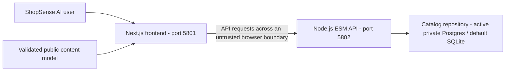

The API is the data authority, but only the identity/ownership controls actually implemented below can be relied on. CORS is not authentication.

### C4 Context

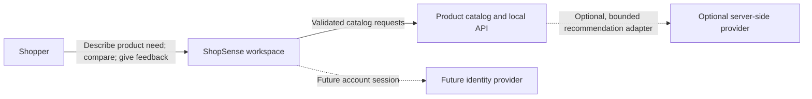

### C4 Containers and Current Data Flow

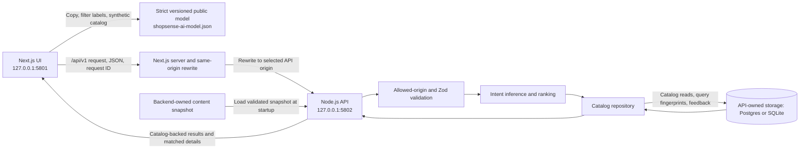

Trust boundaries: browser-to-Next.js (same-origin requests), Next.js-to-API (loopback rewrite), and API-to-database (only the API opens the selected Postgres or SQLite profile). The API validates the forwarded origin, schemas, and bounded request bodies. CORS is not authorization. The Gemini boundary is server-only, requires private backend configuration and is requested automatically by the shopper form, and has bounded requests and responses.

## 3. Source ownership and module map

| Owner/path                                                                                                                       | Responsibility                                                               |
| -------------------------------------------------------------------------------------------------------------------------------- | ---------------------------------------------------------------------------- |
| [src/main.mjs](../src/main.mjs)<br>[src/server.mjs](../src/server.mjs)                                                           | Process bootstrap, HTTP composition, and configuration                       |
| [src/http/api-router.mjs](../src/http/api-router.mjs)                                                                            | HTTP route and request-adapter owners                                        |
| [src/recommendation.service.mjs](../src/recommendation.service.mjs)                                                              | Application workflow/state-machine owners                                    |
| [src/catalog.repository.mjs](../src/catalog.repository.mjs)                                                                      | Storage/transaction owners; memory where implemented                         |
| [src/types/model.schema.mjs](../src/types/model.schema.mjs)                                                                      | Validation/schema and migration authority                                    |
| [src/services/rate-limiter.mjs](../src/services/rate-limiter.mjs)                                                                | Existing session/role/limiter modules; their presence is not a hosting claim |
| [src/observability/logging.mjs](../src/observability/logging.mjs)                                                                | Safe errors, origin handling, or request correlation as implemented          |
| [openapi.yaml](../openapi.yaml)                                                                                                  | Published request/response contract source                                   |
| [.github/workflows](../.github/workflows)                                                                                        | Configured CI; hosted outcomes require separate verification                 |
| [src/catalog.repository.test.mjs](../src/catalog.repository.test.mjs)<br>[src/http/errors.test.mjs](../src/http/errors.test.mjs) | Examples of existing colocated tests                                         |

The source map follows the existing framework directories and test placement.

## 4. Screens, navigation, and lifecycle

This repository has no rendered screens. It supports the frontend through the HTTP/domain contracts in sections 5–7. Its lifecycle entry, response/error mapping, session behavior where present, and storage ownership are listed in section 3. Startup health is http://127.0.0.1:5802/api/v1/health; that configured address is not evidence of a running service. Persistent state is owned by this backend; preserve existing database files during changes.

## 5. Primary workflows and recovery

### Ten User Flows

The browser is not authenticated. Product state is catalog-owned; saved IDs and
appearance are browser-local; search fingerprints and feedback are API-owned.

#### 1. Open discovery

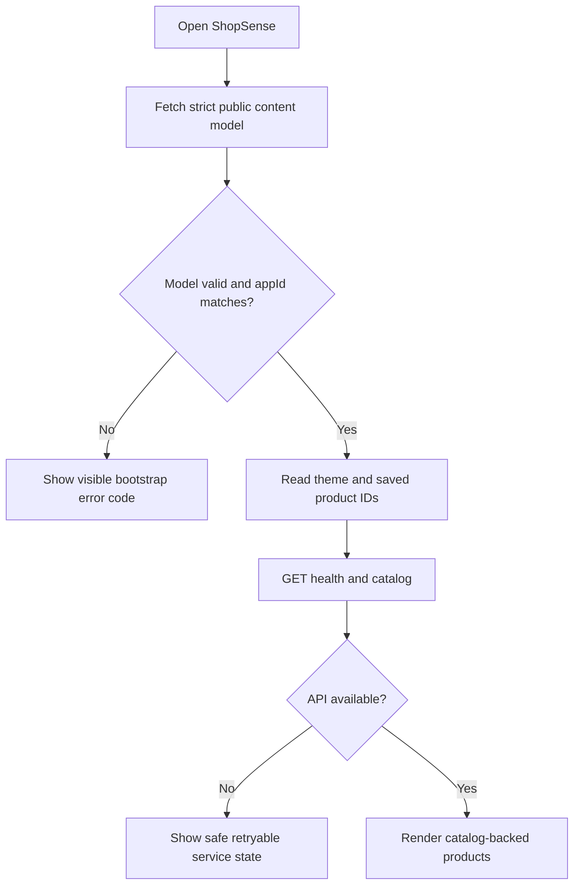

#### 2. Submit a product need

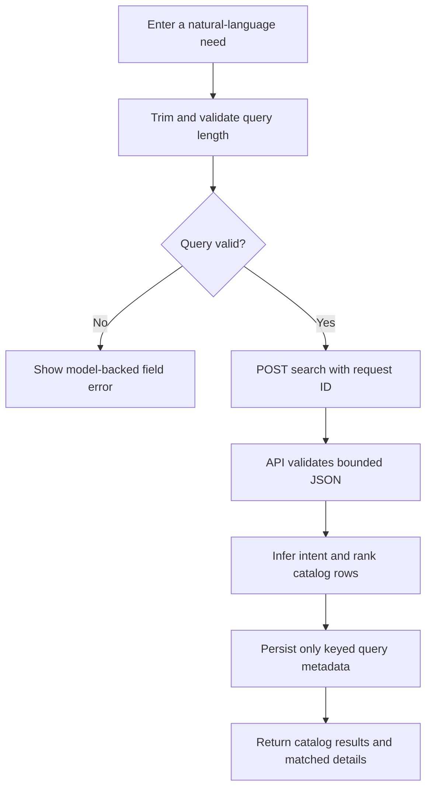

#### 3. Infer catalog intent

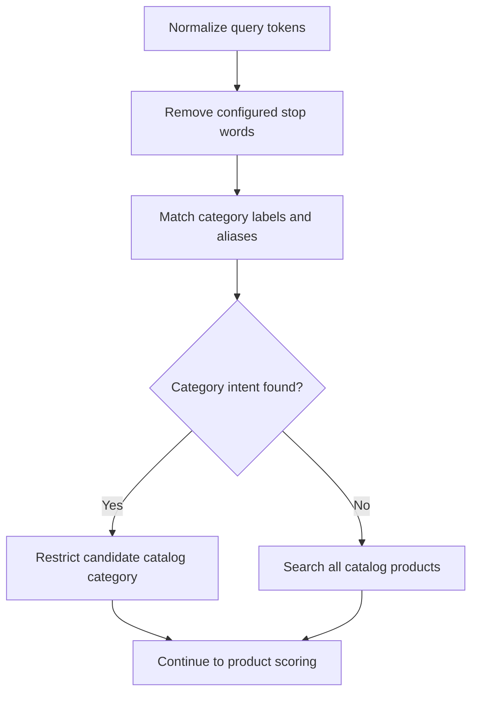

#### 4. Retrieve catalog items

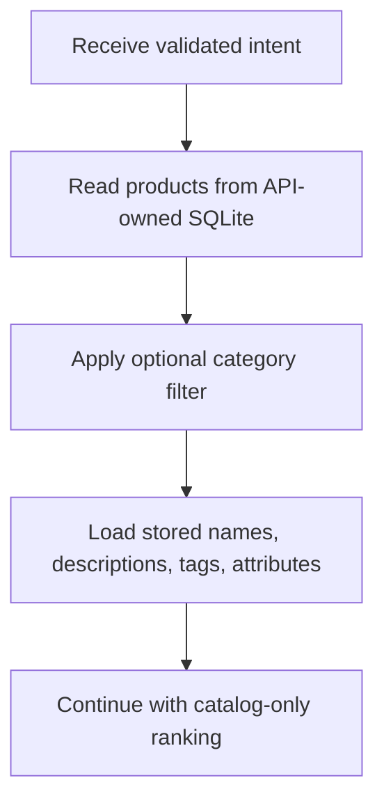

#### 5. Rank grounded matches

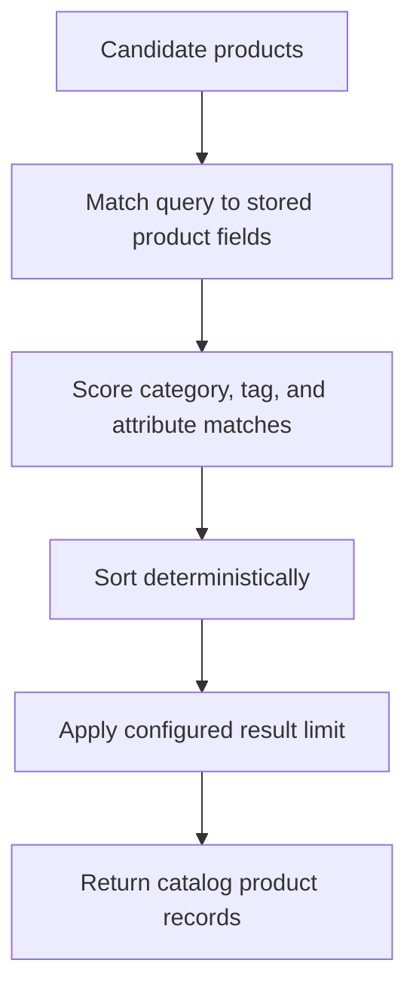

#### 6. Explain a match

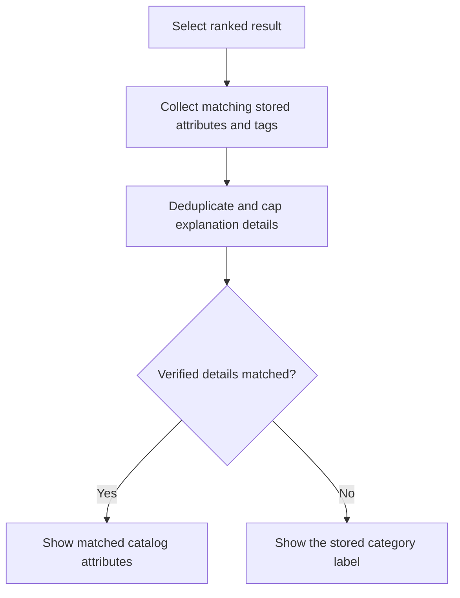

#### 7. Compare products

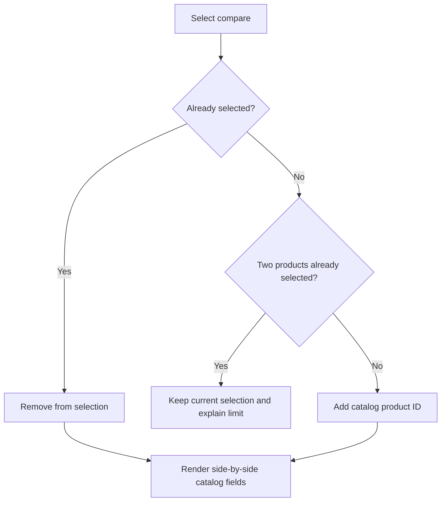

#### 8. Save a product

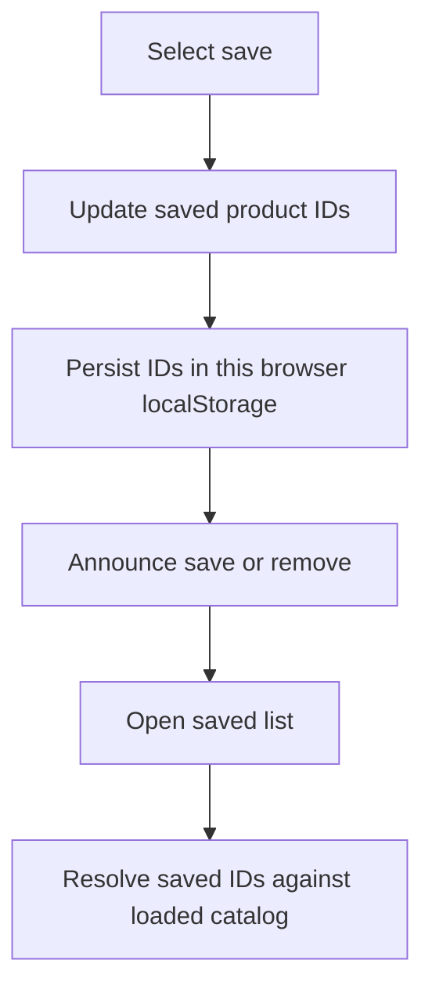

#### 9. Send feedback

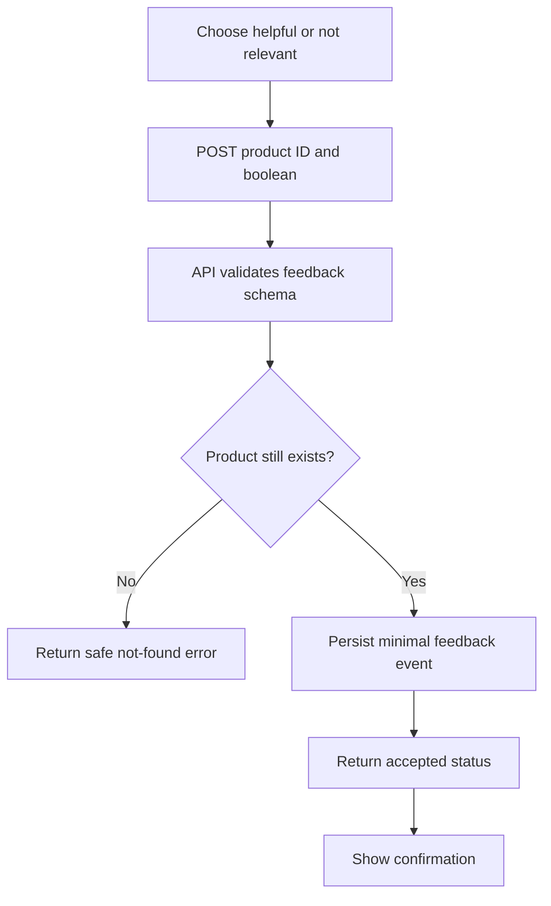

#### 10. Recover from no match or API failure

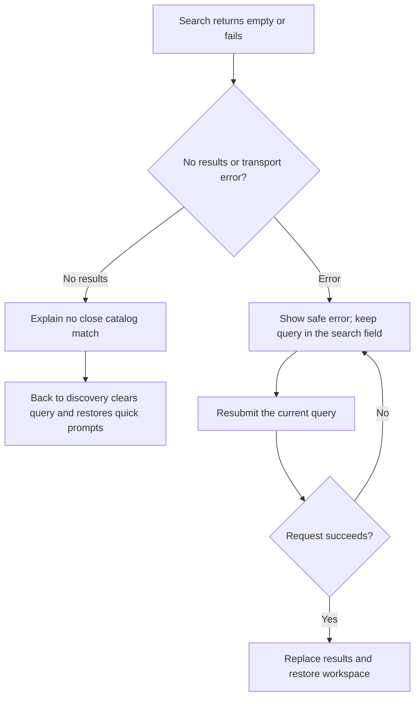

### Use-Case Preconditions, State, and Recovery

These are the implemented local workflows; planned identity, editor, and
cross-app integrations are not prerequisites and are not represented as current
behavior.

| Use case                          | Actor and preconditions                                                             | State/data changes                                                                                                     | Failure and recovery                                                                                       |
| --------------------------------- | ----------------------------------------------------------------------------------- | ---------------------------------------------------------------------------------------------------------------------- | ---------------------------------------------------------------------------------------------------------- |
| Open discovery                    | Shopper; Next.js UI and strict model are reachable.                                 | Reads theme/saved IDs from this browser; requests health and catalog.                                                  | Invalid model shows `CONTENT_MODEL_UNAVAILABLE`; API errors show safe retryable catalog state.             |
| Submit product need               | Shopper; trimmed query is 3–240 characters and body is within the model byte limit. | API ranks current catalog and stores a keyed fingerprint plus minimal query metadata; raw text is not stored.          | Validation/rate/API errors use safe model copy; query remains available for another submit.                |
| Infer catalog intent              | API internal step; validated query and category aliases exist.                      | No separate write; stop words are removed and category ID is inferred or remains `null`.                               | Unknown intent searches all catalog products rather than fabricating a category.                           |
| Retrieve catalog items            | API internal step; optional category must be in the model.                          | Reads products and their stored attributes from SQLite.                                                                | Invalid categories return `INVALID_CATEGORY`; UI can clear the filter or retry.                            |
| Rank grounded matches             | API internal step; retrieved rows are the only candidates.                          | Deterministic field/tag/attribute/category scores, stable name tie-break, configured result cap.                       | Zero scores produce a no-match response with no product.                                                   |
| Explain a match                   | API internal step; candidate has stored attributes/tags or a configured category.   | Returns at most three distinct matched details, falling back only to a stored category label.                          | With no verified details or label, returns an empty detail list; no generated claim is added.              |
| Compare products                  | Shopper; products are in the loaded catalog.                                        | Compare IDs stay in component state; at most two product records are rendered side by side.                            | Third selection is disabled and the limit is explained; remove/clear to choose another pair.               |
| Save a product                    | Shopper; product is in the loaded catalog.                                          | Stable product ID is stored in browser `localStorage`; no account or API write.                                        | Corrupt storage is ignored and reset to an empty list; removed catalog IDs are omitted from display.       |
| Send feedback                     | Shopper; product ID and helpful/not-relevant choice are supplied.                   | API verifies product existence and inserts a minimal feedback record.                                                  | Safe validation/not-found/API copy; buttons remain available when the request fails.                       |
| Recover from no match/API failure | Shopper; current search and model copy are available.                               | No-match “Back to discovery” clears the active search; offline state tracks browser connectivity and reconnect health. | Catalog retry refreshes health/data; search may be resubmitted; safe errors do not expose backend details. |

## 6. Domain, persistence, and data ownership

The API owns the current persistence boundary. Keep database engines, schema/migration order, exact-money rules where applicable, and transaction invariants consistent with executable source.

### Data Ownership and ERD

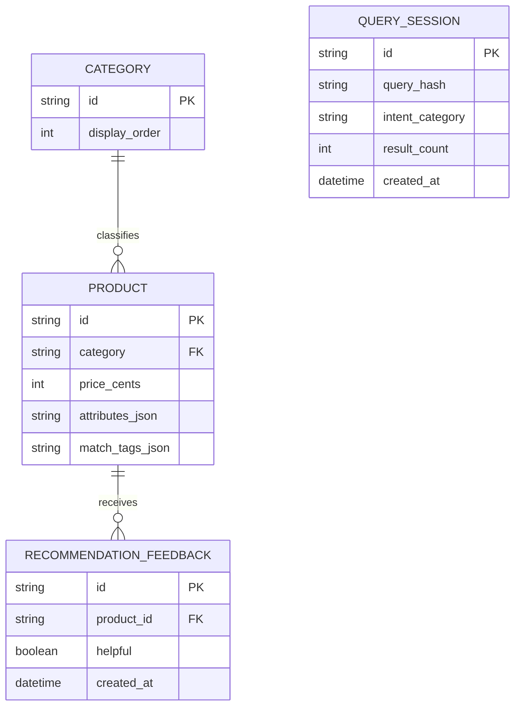

The API owns `categories`, `products`, `query_sessions`, and `recommendation_feedback`. Product and category seeds come from the public content model. New query-session fingerprints use HMAC-SHA-256 with a random process-local key; the raw query is not stored or logged, and fingerprints do not correlate across restarts. Existing databases created before that change may still contain legacy unkeyed hashes. Product prices use integer cents. SQLite constraints and parameterized repository statements protect local invariants. The initial seed is atomic, but the schema currently uses `CREATE TABLE IF NOT EXISTS` and has no versioned migration system. Because seed inserts ignore conflicts, replace the local SQLite file after changing seed product/category data. Tests use in-memory SQLite; the running API stores its file in `shopsense-backend/data/`.

## 7. API and internal contracts

The repository contract is [openapi.yaml](../openapi.yaml). Keep public paths, status/error envelopes, headers, payload validation, and compatibility tied to that source.

### API Contract

| Method | Route              | Request                     | Result                                      |
| ------ | ------------------ | --------------------------- | ------------------------------------------- |
| GET    | `/api/v1/health`   | None                        | Service and selected-storage readiness                |
| GET    | `/api/v1/catalog`  | Optional validated category | Catalog rows and stored attributes          |
| POST   | `/api/v1/search`   | Bounded query, useAi, facets         | Ranked catalog products and matched details |
| POST   | `/api/v1/feedback` | `{ productId, helpful }`    | Persisted feedback acceptance               |
| GET | `/api/v1/store-layout` | None | Versioned original virtual aisles and racks |
| GET | `/api/v2/locations` | None | Store locations known to the offer projection |
| GET | `/api/v2/catalog` | Optional `location`, `category`, `limit`, `offset`, `ids` | Published offers with store availability, `unavailableIds` and catalog freshness |
| POST | `/api/v2/search` | Bounded query, `useAi`, optional `location`, facets and `availableOnly` | Offer matches with availability, attribute-linked `matches` and freshness |
| GET | `/api/v2/feed-status` | None | Feed state (`empty`/`ready`/`stale`), counts and freshness for the staff page |

Success responses use `{ data }`; failures use `{ error: { code, message, requestId } }`. The complete request/response contract is in [`shopsense-backend/openapi.yaml`](../openapi.yaml). `X-Request-ID` and `X-Trace-ID` are returned on responses; request IDs are included in structured logs. Request bodies and raw queries are not logged.

## 8. Security, privacy, and egress

Current release limitation: **Shopper/catalog-editor identity and authorization are not established. Most merchandise remains illustrative. Comparison focus trapping/restoration is verified; full accessibility remains unmeasured. Historical IT image smoke failed; a local pass does not establish production readiness.**

### Authorization and API Ownership Matrix

The local API has no authenticated principals, shopper accounts, roles, or
catalog-editor capability. The allowlisted `Origin` check is a browser boundary,
not authentication or authorization. Loopback binding is the current exposure
limit.

| Route            | Current actor and authorization                                                             | Reads/writes                                                                                    | Expected failures and recovery                                                                                               |
| ---------------- | ------------------------------------------------------------------------------------------- | ----------------------------------------------------------------------------------------------- | ---------------------------------------------------------------------------------------------------------------------------- |
| `GET /health`    | Any local caller; no identity check. Health is excluded from rate limiting.                 | Reports API/storage readiness; no domain write.                                                  | Safe internal error; restart/check local database if unavailable.                                                            |
| `GET /catalog`   | Unauthenticated local browser or caller; optional category must exist in the public model.  | Reads catalog rows from the selected API-owned storage profile.                                                       | `INVALID_CATEGORY`, `ORIGIN_NOT_ALLOWED`, or `RATE_LIMITED`; correct the filter or retry later.                              |
| `POST /search`   | Unauthenticated local browser or caller; strict JSON, bounded body, query length 3–240.     | Reads catalog; stores only a keyed fingerprint, inferred category, result count, and timestamp. | `INVALID_JSON`, `PAYLOAD_TOO_LARGE`, `INVALID_SEARCH`, `RATE_LIMITED`, or safe `INTERNAL_ERROR`; keep the query and retry.   |
| `POST /feedback` | Unauthenticated local browser or caller; strict product ID and boolean; product must exist. | Reads product, then inserts minimal feedback.                                                   | `INVALID_FEEDBACK`, `PRODUCT_NOT_FOUND`, `RATE_LIMITED`, or safe `INTERNAL_ERROR`; retry the feedback action if appropriate. |
| `GET /v2/locations`, `GET /v2/catalog` | Unauthenticated local browser or caller; store ID must exist; `ids` capped at 50. | Reads the SQLite offer projection only; no write. | `INVALID_LOCATION`, `INVALID_REQUEST`, `RATE_LIMITED`; `OFFERS_NOT_SUPPORTED` (501) on profiles without the projection. |
| `POST /v2/search` | Unauthenticated local browser or caller; strict JSON; `availableOnly` requires a store. | Reads offers; stores the same keyed fingerprint record as v1. | `INVALID_SEARCH`, `INVALID_LOCATION`, `PAYLOAD_TOO_LARGE`, `RATE_LIMITED`, 501 as above; keep the query and retry. |
| `GET /v2/feed-status` | Unauthenticated local caller (the `/staff` page). It is read-only and returns counts and timestamps only. | Reads aggregate offer/location counts; no write. | `RATE_LIMITED`, 501 as above. Requires staff identity before any remote exposure. |
| Offer writes | No HTTP route. Only in-process `publishOffer`, `withdrawOffer` and `recordAvailability`, called by the startup feed and tests. | Versioned upserts in one transaction per feed. | Invalid identifiers/timestamps throw and roll the whole feed back. |
| Other paths      | No route or elevated actor exists.                                                          | No domain read/write.                                                                           | Safe `NOT_FOUND` response.                                                                                                   |

`SHOPSENSE_ALLOWED_ORIGINS` may replace the model origin list. The process-local
rate limiter defaults to 120 requests per minute per remote address, excluding
health. It is not a distributed quota or identity control.

### Integrations, Modes, and Observability

| Integration or mode        | Current behavior                                                                                                                                                                            |
| -------------------------- | ------------------------------------------------------------------------------------------------------------------------------------------------------------------------------------------- |
| Product catalog            | Synthetic catalog owned by the API: active private Postgres profile, default SQLite; packaged backend content snapshot.                                                                                                             |
| Recommendation provider    | Shopper searches request configured AI selection automatically; catalog IDs/evidence are validated before rendering, with explicit catalog fallback.                                                                                                                     |
| Identity and authorization | Not implemented. No user/account or editor role is accepted.                                                                                                                                |
| Mock mode                  | `NEXT_PUBLIC_IS_MOCK=true` selects the configured mock API origin. The local mock path still calls the same REST API and uses seeded synthetic data; it is not an in-browser fake response. |
| Live mode                  | `NEXT_PUBLIC_IS_MOCK=false` selects `SHOPSENSE_REAL_API_URL`. E2E uses the isolated local API as the selected endpoint; this does not prove a production/third-party integration.           |
| Telemetry                  | API emits JSON request/startup events with request/trace IDs, route template, method, status, duration, outcome, and safe error code. It omits request bodies and raw queries.              |

Keep private credentials out of public models, browser bundles, logs, URLs, and source archives. The existing remote Unsplash image dependency remains; Gemini is server-only and requested automatically by the shopper form when configured; explicit fallback attribution remains. Keep logs limited to the source-defined request/trace and safe aggregate fields. Backups, retention, deletion, and real-user ownership need explicit product/operations decisions before external exposure.

## 9. Design, accessibility, and platform adapters

There is no visual rendering or native package in this API repository. Preserve safe errors and stable contracts so the frontend can present accessible recovery states. Hardware scanning, banking/payment rails, shipping providers, and native integrations remain limited to what the current source actually implements; simulator behavior is not device/provider integration.

## 10. Build, checks, and deployment

Configured npm scripts, from this repository with Node **24.15.0**; use `npm.cmd` in PowerShell:

| Command                    | Actual manifest definition                                                                                                                                                                   |
| -------------------------- | -------------------------------------------------------------------------------------------------------------------------------------------------------------------------------------------- |
| `npm.cmd run dev`          | `node --watch src/main.mjs`                                                                                                                                                                  |
| `npm.cmd run start`        | `node src/main.mjs`                                                                                                                                                                          |
| `npm.cmd run test`         | `node --test`                                                                                                                                                                                |
| `npm.cmd run test:cov`     | `c8 --all --include="src/**/*.mjs" --exclude="src/**/*.test.mjs" --exclude="src/main.mjs" --check-coverage --lines 90 --branches 90 --functions 90 --statements 90 --reporter=text npm test` |
| `npm.cmd run check`        | `node --check src/main.mjs && node --check src/server.mjs`                                                                                                                                   |
| `npm.cmd run lint`         | `eslint src`                                                                                                                                                                                 |
| `npm.cmd run format:check` | `prettier --check "src/**/*.mjs" "eslint.config.mjs" ".github/workflows/*.yml" "openapi.yaml"`                                                                                               |

Install with `npm.cmd ci` and retain [package-lock.json](../package-lock.json). Registry access is required for a clean dependency installation. These commands describe the configured checks; execution results are listed in section 13.

The API remains loopback-only. Direct-start storage is `data/shopsense.sqlite` relative to this repository. The backend-owned `data/shopsense-ai-model.json` is the seed/content input. The entrypoint loads ignored `.env.local`; explicit process environment variables take precedence.

CI configuration is listed in section 3. Run the configured checks before merging or releasing. Deployment requires separate verification of the selected hosting environment.

## 11. Architecture decisions and tradeoffs

### Implemented Design Patterns and Invariants

- The application is a local modular monolith, not a set of independently
  deployed microservices. The frontend is a presentation/client-state boundary;
  the API is the only application database client.
- The backend request path is HTTP handler -> route/schema validation ->
  recommendation service -> repository. The ranker is a deterministic domain
  service; it has no external model dependency on the default path; opted-in requests use the bounded Gemini adapter.
- One strict `version/appId/locale/messages/data` model feeds frontend copy and
  synthetic seed data. Both frontend and backend validate it at their trust
  boundary. The old public architecture model and UI route are removed.
- Catalog reads and writes use a repository boundary, parameterized SQL,
  foreign keys, constraints, and an atomic transaction for initial seed data.
  `INSERT OR IGNORE` preserves existing rows; it does not migrate changed seed
  content into an existing local database.
- Recommendation explanations are assembled only from matched stored
  attributes/tags or the stored category label. Sorting is deterministic and
  results are capped by the model.
- The browser owns only saved product IDs, appearance preference, active search,
  and compare selection. Saved IDs resolve against the latest catalog; compare
  selection is capped at two and is not persisted.
- New query records contain a keyed HMAC fingerprint, inferred category,
  result count, and timestamp. The key is random and process-local; raw queries
  and request bodies are not persisted or logged. A transaction writes the
  seed, but query and feedback events are independent inserts.
- API failures use a stable, model-backed error code/message/request-ID
  envelope. Unexpected internal details are not returned to the browser.

The two Git repositories remain separate. Each owns one maintained README and this repository-local architecture guide. Shared application behavior may be described here for contract context, but implementation changes belong to the owning source module.

## 12. Requirements traceability

| Capability                       | Acceptance                                                        | Owner/path                         | Current status                                                | Evidence                               | Risk                                                                                                                                                                                                                      |
| -------------------------------- | ----------------------------------------------------------------- | ---------------------------------- | ------------------------------------------------------------- | -------------------------------------- | ------------------------------------------------------------------------------------------------------------------------------------------------------------------------------------------------------------------------- |
| Repository-local architecture    | Guide available in this checkout and linked from README           | docs/architecture.md; README.md    | Documented and validated                                      | File, link, and diagram checks         | Keep documentation consistent with source changes                                                                                                                                                                         |
| API composition and domain state | Preserve existing workflows and failure states                    | src/server.mjs and source map      | Implemented; application verification limits are listed below | Current source and existing app design | Shopper/catalog-editor identity and authorization are not established. Most merchandise remains illustrative. Comparison focus trapping/restoration is verified; full accessibility remains unmeasured. Historical IT image smoke failed; a local pass does not establish production readiness. |
| Public deployment                | Verified identity, data durability, recovery, and hosted behavior | Existing deployment/API boundaries | Needs separate hardening/verification                         | No new hosted evidence                 | Local checks do not establish production readiness                                                                                                                                                                        |
| SS-01 published offers | Offer carries merchant ID, SKU, source version, price, currency, update time; duplicate update keeps one row; withdrawal hides it from search, compare refresh and id lookup; empty install is distinguishable | src/offers/offer-store.mjs, offer-feed.mjs, src/http/offers-router.mjs | Implemented, SQLite profile only | `offer-store.test.mjs`, `offer-feed.test.mjs`, `offers-router.test.mjs` | Synthetic feed only; no CommerceHub integration; Postgres answers 501 |
| SS-02 constraints before ranking | Store, audience, colour and price apply before ranking; missing or stale stock never reads as in stock | src/offers/offer-discovery.mjs, availability.mjs | Implemented | `offer-discovery.test.mjs` (SS-02 acceptance, boundary, ranking-cap cases) | Freshness limit is a single global setting |
| SS-03 provider-free grounded search | Works with every remote provider disabled; matches link to stored attributes; results carry freshness | src/http/offers-router.mjs, src/offers/offer-discovery.mjs | Implemented | `offers-router.test.mjs` (no outbound call; invented IDs; timeout) | Optional provider path unchanged and off by default |

## 13. Dated verification and limitations

Last documentation review: **2026-11-09**. The checks below distinguish documentation validation from application and deployment testing.

- Repository-local guide, README link, source-path references, section/contents anchors, and Mermaid syntax: passed documentation validation.
- New application tests/builds, coverage, dependency audits, browser/device accessibility/performance, hosted CI, and Vercel deployment: **not rerun for the documentation updates**.
- Frontend production builds passed on 2026-11-09 with Node 24.15.0. Build success does not establish that all application quality gates pass.
- Historical outstanding baseline limit: Shopper/catalog-editor identity and authorization are not established. Remote Unsplash images and dialog-focus work remain; formatting and generated-type ordering were corrected on November 13, 2026. IT image smoke failed; do not label all checks passing.

The baseline results below record earlier validation. Re-run the listed commands against the current revision before release.

Previously recorded application verification:

### Verification and Known Gaps

Run the API from `shopsense-backend` and the UI from `shopsense-frontend` in
separate terminals. Use Node.js 22.13 or later.

```sh
cd shopsense-backend
npm ci
npm run dev
```

```sh
cd shopsense-frontend
npm ci
npm run dev
```

Backend checks: `npm run format:check`, `npm run lint`, `npm run check`,
`npm test`, `npm run test:cov`, and `npm audit`. Frontend checks:
`npm run format:check`, `npm run lint`, `npm run typecheck`, `npm run test:unit`,
`npm run test:cov`, `npm audit`, and both `npm run test:e2e` and
`NEXT_PUBLIC_IS_MOCK=false npm run test:e2e`. Unit/API tests use synthetic
fixtures and in-memory SQLite. Playwright builds into an ignored test directory,
uses ports 5881/5882, and starts an in-memory SQLite API; it does not reuse
services or databases on ports 5801/5802. Coverage gates require at least 90%
for statements, branches, functions, and lines.

Known gaps: no identity/role/record ownership, no catalog editor, no
versioned SQLite migration or seed-update workflow, no distributed rate limit,
no persistent HMAC key rotation or TLS. Gemini is implemented, but this does not establish hosted readiness. Keep
both local services loopback-only and use synthetic data until these controls
are implemented and verified.

## 14. Extension rules and companion repository

Start with [README.md](../README.md) and this guide. The companion repository is [shopsense-frontend](https://github.com/gopichand-retail-apps/shopsense-frontend); clone the pair as siblings for the supplied combined local/E2E workflow and content authoring sync. Backend runtime and backend CI read the backend-owned content snapshot and do not require a sibling checkout. This guide is inside the current repository and does not depend on a parent-folder architecture file to exist.

Update this guide when owned source, routes, persistence, identity, UI states, egress, or deployment behavior changes. Coordinate public contract changes with the companion repository and tests. Preserve existing data, run isolated checks with synthetic records, record failures, and review release and infrastructure changes before publication.

## Catalog, voice, AI, and hosted release path - November 13, 2026

This feature increment follows the archived reconstruction. Earlier numbered sections retain design and
historical verification context; this section describes the current implementation. The UI and API remain on
loopback with synthetic data; the active private profile uses hosted Supabase Postgres. No hosted UI/API
deployment or customer account system is established.

### How discovery works

The catalog contains **308 products**: eight preserved originals plus 30 synthetic examples in each of ten
families: dresses, shirts, pants, shoes, headphones, earbuds, bottles, mugs, sunglasses, and backpacks.
Synthetic apparel covers women, men, and kids. Examples are labeled ShopSense Sample; an AirPods query
maps to the earbuds type and does not establish genuine Apple inventory. Fifty original local SVG
illustrations are reused across the 300 additions. The original remote image records remain unchanged.

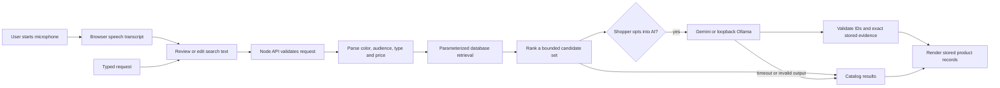

Explicit facets are applied before model selection. Tests verify that `black dress for men` returns only
the two matching men's examples, while `black dress` matches six examples across apparel audiences.
The parser handles documented aliases, price comparisons, and simple excluded colors; arbitrary complex
language is not guaranteed. Missing stock is never invented. The local ranker works without credentials.
SQLite retrieval caps its internal candidate pool at 2,000; ranking sends at most 36 candidates to Gemini
or 12 to Ollama. This implementation has not been load-tested at marketplace scale.

Browsing requests **24 products per page**, with a maximum API page size of 100. Saved IDs are resolved
in separate bounded requests, so saving a search result outside the first page survives reload. The UI
does not download the whole catalog. Search returns at most the configured six recommendations and
also reports matched-count/filter metadata. A catalog API-origin selector does not select an AI provider.

Voice uses the browser's SpeechRecognition or webkitSpeechRecognition after an explicit click. A transcript
fills the editable text field without submitting automatically. Permission, network, unsupported-browser,
and no-speech states retain text entry. No audio is stored by this app. Browser recognition may send
audio to its own cloud service; using Ollama does not make speech recognition offline. Physical microphone
capture and recognition accuracy remain untested.

### Where product details and images belong

Product records belong in a database: IDs, tenant/category, names, integer-cent prices, tags, color,
audience, product type, and image references. Future stock quantities would also be authoritative data;
the current sample catalog has no live inventory feed. Image files belong in object storage with a CDN;
the database stores their references. The default profile uses SQLite and checked-in SVG files.
The active ignored local configuration now selects **hosted Supabase Postgres**, with a server-private
`DATABASE_URL` and fixed synthetic `SHOPSENSE_ORGANIZATION_ID`. Fresh setups still default to SQLite.

The backend owns `data/catalog.sample.json`; `npm.cmd run catalog:generate` reproducibly builds its 300
records and the sibling frontend illustrations. Initial startup adds missing seed records without replacing
existing rows. Postgres import is an explicit `npm.cmd run catalog:seed:postgres -- --apply`, runs in a
transaction, and preserves existing IDs. The same transactional seed function prepared the hosted 308-row import, applied through the connected
operator SQL tool. Runtime credentials cannot import or edit products; seeding requires a separate private
operator connection. Do not grant the running app migration or catalog-edit privileges. Both repositories
are still required locally for the original shared content contract.

`supabase/schemas/shopsense.sql` is the declarative source for seven public Postgres tables: organizations,
organization_members, categories, products, query_sessions, feedback, and ai_daily_usage. Composite keys
and foreign keys include organization IDs. Product indexes include facets and full-text GIN. The async
`pg` adapter scopes all operations to the configured organization and limits its connection pool to three.
Use Supabase's recommended pooler configuration for a future serverless deployment.

Local PGlite tests execute both declarative schema files with minimal Supabase auth stubs. They cover
import, pagination/search, rollback, tenant/role denial, allowed editor updates, WITH CHECK, self-promotion,
and a restricted runtime role. `shopsense_runtime.sql` adds an unexposed private runtime_bindings table:
the login can read only its bound store, append anonymous synthetic query/feedback events, and reserve
that store's AI budget. It cannot edit catalog/memberships/bindings or read query history, feedback bodies,
or Vault. RLS is enabled on all eight tables. No role has an anonymous catalog policy.

The active API uses this NOBYPASSRLS runtime login, not postgres or a service-role credential. A Supabase-only
bootstrap generates its password inside the database and stores it encrypted in Vault; no literal password
is written into migration history. A private local connection profile holds the runtime credential.
The checked-in public Supabase CA enables certificate-chain and hostname verification; verification is
never disabled. The database connection was measured as encrypted and authorized, and the login has no
RLS bypass. The CA expires April 26, 2031; replace it through a reviewed trust-anchor update before expiry.

Hosted checks verify 308 visible products, actual cross-store record denial, denied catalog/binding/Vault
access, denied cross-store budget writes, and HTTP 401 for anonymous REST catalog reads. The temporary
second-store fixture was removed after testing. Real browser search uses Gemini with hosted catalog rows,
and feedback persists in Supabase. These are database/runtime checks, **not human sign-in or authenticated
HTTP tenant-isolation evidence**. The API still has no shopper principal and must remain on loopback.

Supabase Storage upload, tenant image paths/ACLs, thumbnails, import administration, and merchant image
licensing are future work. As an illustration, 1,000 images at 200KB each need about 200MB before variants
and overhead; bandwidth is a separate quota. Current Supabase Free lists 500MB database and 1GB files,
with 5GB egress and inactivity pausing. Capacity and production availability are not guaranteed.

### Provider configuration and limits

Only the backend reads ignored `.env.local`; process variables take precedence. Never put keys in
`NEXT_PUBLIC_*`, the public UI model, source control, URLs, or logs. The shopper's AI option starts off.
Only opted-in searches call the configured model, using a bounded query and catalog shortlist. Unknown
IDs, duplicate products, invalid evidence, price violations, oversized/truncated output, and provider
failure are rejected. Display facts always come from stored records; model output cannot edit inventory.

| Configuration | Behavior |
| --- | --- |
| `SHOPSENSE_AI_PROVIDER=local` | Deterministic catalog discovery without an LLM. |
| `SHOPSENSE_AI_PROVIDER=gemini` and private `GEMINI_API_KEY` | Opted-in Gemini selection; default model `gemini-3.5-flash-lite`, 8-second timeout. |
| `SHOPSENSE_AI_PROVIDER=ollama` | Opted-in local selection using `OLLAMA_BASE_URL`, `OLLAMA_MODEL`, and 30-second default timeout. |
| `SHOPSENSE_AI_FALLBACK_PROVIDER=ollama` | Explicit Gemini-to-Ollama recovery, then labeled catalog fallback; default is `none`. |

Ollama endpoints accept loopback HTTP only. The adapter does not download models or start a server.
It uses at most 12 candidates, 4,096 context tokens, 1,024 output tokens, and `keep_alive:0`.
The active development profile remains Gemini. Ollama provider-double tests pass, but real local
generation is unverified. A cloud function's localhost cannot reach a laptop. A self-hosted server must
remain running and reachable; a hosted model API is the simpler public-demo path.

The application reserves up to **50 AI searches per UTC day** by default, including failures, using an
atomic persistent database counter. It allows two concurrent AI requests per process. There are no
automatic retries. These are application guards, not a billing cap or Google's allowance. Actual Gemini
RPM/TPM/RPD limits depend on the project and model; inspect AI Studio. Google's daily quota resets at
midnight Pacific. Creating another API key does not create a separate project quota.

Groq and Grok are different providers. Groq and Cloudflare offer limited developer allowances; Cloudflare's
10,000 neurons/day is compute rather than a request count. Free consumer Grok does not imply free xAI API
access. Groq/Cloudflare/xAI adapters are not implemented. Hosted-provider fallback requires explicit
configuration, compatible structured output, privacy disclosure, and independently authorized capacity.
Consumer subscriptions do not include application API usage by default.

Sources: [Gemini quotas](https://ai.google.dev/gemini-api/docs/rate-limits),
[Gemini pricing and content handling](https://ai.google.dev/gemini-api/docs/pricing),
[Groq quotas](https://console.groq.com/docs/rate-limits),
[Cloudflare allowance](https://developers.cloudflare.com/workers-ai/platform/pricing/),
[xAI pricing](https://x.ai/pricing), [Supabase pricing](https://supabase.com/pricing),
[Postgres connections](https://supabase.com/docs/guides/database/connecting-to-postgres),
[SpeechRecognition](https://developer.mozilla.org/en-US/docs/Web/API/SpeechRecognition),
[SQLite on Vercel](https://vercel.com/kb/guide/is-sqlite-supported-in-vercel).

### Hosted release sequence

The dedicated Supabase project **shopsense-ai** (`ixotpmxfdhgooqmybnpk`) was created in
gopichandchikoti's Org in us-east-1 with a quoted cost of **$0/month**. It is active/healthy on Postgres 17.
The existing retail-apps project was untouched. Three baseline/isolation/credential-bootstrap migrations
were applied, then exported from the hosted migration history using the server-generated versions into
`supabase/migrations/`. Declarative files remain the desired-schema source; do not rewrite applied history.
Full local Supabase CLI reset/replay has not been run; local schema tests use PGlite instead.

The catalog import and local-API-to-cloud-database connection are verified. Security and health advisors
return no findings. Performance advisors retain informational unused-index notices on this small new
dataset; missing foreign-key indexes were added. This is not a performance benchmark or security audit.
No billing upgrade, GitHub push, Vercel project/deployment, or public UI/API exposure was performed.
Dashboard: https://supabase.com/dashboard/project/ixotpmxfdhgooqmybnpk.
Advisor reference: https://supabase.com/docs/guides/database/database-linter?lint=0005_unused_index.

1. Hosted schema/import are verified. Add Supabase Auth and
   server-verified membership/roles, company onboarding and invitations, and owned saved lists/feedback.
   Test two companies and owner/editor/employee denial through the actual HTTP API, not just SQL.
2. Add controlled merchant catalog/image import, storage policies and provenance, identity-based quotas,
   retention, backup/restore, monitoring, and operational budgets. Current sample inventory has no business
   stock feed or checkout. Training a foundation model is unnecessary; retrieval keeps business facts fresh.
3. Implement and verify an API deployment adapter and deployment-owned content artifact for the separate
   API project, replace loopback rewrites with HTTPS, and use protected Vercel previews. Vercel Hobby's
   personal/noncommercial restrictions must be reviewed before selling the service.
4. Verify hosted auth, tenant isolation, durable state/restarts, recovery, quota/error behavior, images,
   keyboard/dialog access, physical microphone behavior, mobile UI, relevance/negation, and measured latency.
   A local pass is not production certification. No GitHub push or hosted CI result is claimed.

### Historical local verification — November 13, 2026

Windows with Node 24.15.0: **75 backend tests** pass (99.9% statements/lines, 97.29% branches, 100%
functions); **49 frontend tests** pass (95.92% statements, 92.4% branches, 96.96% functions, 97.89% lines).
All **21 Playwright checks pass in each API-origin mode**, using isolated in-memory SQLite and AI doubles.
These include multi-page browsing, saved IDs outside the first page, strict audience facets, simulated
speech transcription/review, and a 320px layout check. Physical speech and real Ollama inference are unrun.
Formatting, lint, backend syntax, frontend type generation/typecheck, production build, and both dependency
audits pass with zero advisories. `check:ai` separately verifies a real-provider discovery plus pipeline
price/no-match behavior; no-candidate searches can finish without calling the model.

The hosted-data increment reran backend coverage/format/lint/syntax/audit and the real current browser
search/feedback flow. Frontend unit/E2E/build counts above are the preceding same-day checks; frontend
source was unchanged in this hosted-data increment. The final hosted browser flow and persistence after
API restart pass. TLS rejects an untrusted certificate chain; the explicit provider CA verifies the chain
and hostname.

## Customer-discovery architecture — November 17, 2026

This section records current behavior and supersedes the explicitly dated November 13 implementation
notes above where behavior changed. Earlier Gemini 3.5, checkbox opt-in, and 75/49/21 test counts describe
that historical increment. Current implementation and verification are in the
[customer-discovery release record](releases/2026-11-17-customer-discovery.md).

The shopper enters a need, refines Collection/Color/Budget, and submits an automatic AI-assisted search.
The frontend sends `query`, `useAi: true`, and optional strict facets through its same-origin Next rewrite.
The API intersects the facets with parsed query constraints, retrieves stored rows, and sends a bounded
shortlist to the configured provider. It resolves the returned IDs and evidence back to catalog facts;
contradictory or empty retrieval returns no invented products and makes no model call. Omitted/false
`useAi` remains supported for existing API clients. The verified Gemini default is
`gemini-3.1-flash-lite` with the existing 8-second timeout, two concurrent calls, and 50 daily reservations.

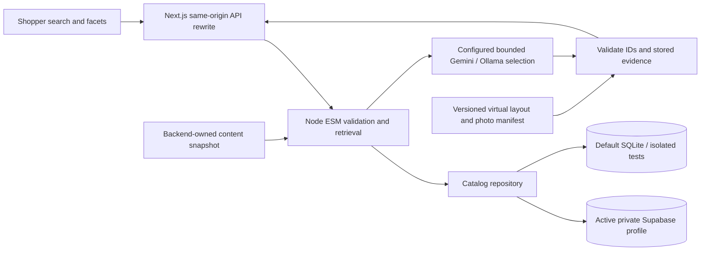

`data/shopsense-ai-model.json` is packaged with the backend. The sync script is an authoring operation,
not a runtime sibling file dependency. `data/store-layout.json` defines an original virtual store with
versioned aisles/racks. A repository wrapper derives aisle/rack/shelf labels and applies reviewed photo
overrides before responses. Layout and photo enrichment are source-controlled artifacts; there is no
new placement database table, merchant inventory feed, or schema/RLS migration in this increment.

The three local Pexels photographs and their provenance cover matching black shirts, women's black
dresses, and black headphones. They are clearly labeled style references. The remaining merchandise
is illustrative artwork or preserved original remote imagery. A production catalog needs licensed
merchant SKU assets and controlled image import/storage; current photos do not establish stock or
a retailer partnership.

The frontend cancels obsolete requests and ignores late results/errors after a new search, clear, cancel,
or unmount. Abort does not guarantee that server/provider work already accepted has stopped. Comparison
locks body scrolling, makes background content inert, traps focus, and restores its trigger on close.
A store guide loads the versioned layout on expansion, with retry and cancellation. Search results show
true returned/total counts, product facts, location labels, and explicit provider/fallback status.

Human authentication, owned saved lists/history, merchant imports, API hosting adaptation, hosted access
protection, durable recovery/restore, physical speech, full accessibility, and measured production
performance remain open. The live browser → Supabase → Gemini validation and exact GitHub/deployment
results are pending the separately recorded release checks; do not infer them from isolated E2E.

## Customer QA update — November 17, 2026

The [customer-discovery release record](releases/2026-11-17-customer-discovery.md) supersedes earlier current-test counts and describes automatic AI, evidence-backed need matching, filters, versioned virtual locations, reviewed photographs, local browser evidence, and the unresolved frontend dependency advisory. Runtime model facts come from the backend snapshot; sibling checkout is an authoring and paired-E2E dependency. Production access and actual merchant commerce remain unfinished.

## Store offers, availability and freshness (SS-01 to SS-03) — November 26, 2026

Stage B slice, local only. Branch `feature/ss-01-03-local-discovery`. The owner approved the additive v2
contract, the SQLite-only projection, feed writes without an HTTP route, and the read-only `/staff` page.

### ADR SS-A2: additive `/api/v2` offer routes

- **Decision.** Add read-only `/api/v2` routes for locations, catalog pages, search and feed status. Leave every
  v1 route and envelope unchanged.
- **Why.** The frontend parses products with strict schemas, so adding fields to v1 would break any deployed
  client that predates this change. The Stage A design also proposed v2.
- **Alternatives.** Extending v1 in place (less code, breaks strict clients); a separate projection service
  (more operating cost, no evidence it is needed).
- **Consequences.** Two route families share the same domain helpers. The optional provider path is reused by
  wrapping the offer discovery service in the existing `createAiRecommendations` orchestrator.

### Data model (SQLite profile)

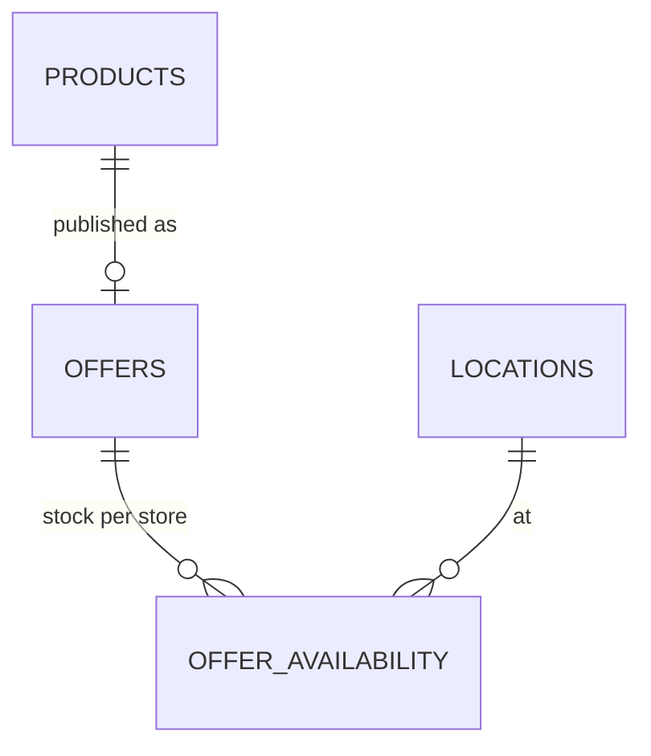

| Table | Key | Columns and rules |
| --- | --- | --- |
| `locations` | `id` | `name`, `display_order` |
| `offers` | `(merchant_id, sku)` | `product_id` (unique, FK products), `source_version > 0`, `offer_price_cents >= 0`, `currency` (3 letters), `updated_at`, `withdrawn_at` |
| `offer_availability` | `(merchant_id, sku, location_id)` | `state` in `in_stock`/`out_of_stock`/`unknown`, `confirmed_at`, `source_version > 0` |

Tables are created at startup with `CREATE TABLE IF NOT EXISTS`, like the existing facet columns. No migration
file was added and `supabase/` is unchanged. The PostgreSQL repository has no `offers` property, so every v2
route answers `501 OFFERS_NOT_SUPPORTED` there while v1 keeps working.

### Write rules (in-process only)

| Operation | Accepted | Ignored or rejected |
| --- | --- | --- |
| `publishOffer` | New offer (`created`); higher source version (`updated`, also clears a withdrawal) | Same version and payload (`unchanged`); lower version or withdrawn at this version (`stale`); same version with a different payload, or a product already owned by another SKU (`conflict`); unknown product |
| `withdrawOffer` | Same or higher version (`withdrawn`) | Lower version (`stale`); repeat at the same version (`unchanged`); unknown offer |
| `recordAvailability` | Higher version, or same version with a newer confirmation (`recorded`) | Older version or confirmation (`stale`); identical (`unchanged`); same time with a different state (`conflict`); withdrawn/unknown offer; unknown store |

Identifiers must match `^[A-Za-z0-9._:-]{1,80}$`; timestamps must be ISO UTC and no more than five minutes in
the future. A feed is applied in one transaction, so one invalid item rolls back the whole feed.

### Availability and freshness rules

- With a store, each item reports `{ locationId, state, confirmedAt, stale }`. Without a store,
  `availability` is `null` and nothing claims stock.
- A record older than `SHOPSENSE_AVAILABILITY_MAX_AGE_MINUTES` (default 1440, range 1 to 10080) is reported as
  `unknown` with `stale: true`. A confirmation exactly at the limit is fresh. A missing record is `unknown`.
  Neither ever reads as `in_stock`.
- `availableOnly` keeps only fresh `in_stock` records at the named store, applied in SQL before ranking, so the
  36-item ranking cap cannot hide an in-stock item. Price bounds use the offer price.
- `catalog.state` is `empty` when no offer is published, `stale` when the newest published update or
  confirmation is older than the limit, otherwise `ready`. `asOf` is that newest timestamp; `generatedAt` is
  the response time.
- Matched details become `matches`: `{ field: "attributes", index, text }` when the text is a stored
  attribute, otherwise `{ field: "tags", text }`.

### Synthetic feed and configuration

`SHOPSENSE_OFFER_FEED=sample` (default) publishes every catalog product as `SYN-<productId>` from merchant
`synthetic-merchant-1` at two synthetic stores (`store-a` Northside, `store-b` Riverside). Deterministic plans
give in-stock, out-of-stock, missing and three-day-old (stale) records. Restarts refresh confirmations without
conflicting on offers. `SHOPSENSE_OFFER_FEED=none` starts an empty install for the onboarding state. No sample
ID is mapped to a real SKU.

### Failure and recovery

| Condition | API result | Client behavior |
| --- | --- | --- |
| Unknown store | 400 `INVALID_LOCATION` | Model copy; choose a listed store |
| `availableOnly` without a store | 400 `INVALID_SEARCH` | The UI disables the filter without a store |
| Nothing published | 200, `catalog.state: "empty"` | Shoppers see "No products published for this store."; staff see "Connect catalog" |
| Nothing fresh | 200, `catalog.state: "stale"` | Stale warning; no item reads as in stock |
| Provider disabled, invalid or timed out | 200 with labeled `assistance` fallback | Catalog results remain usable |
| Storage profile without projection | 501 `OFFERS_NOT_SUPPORTED` | Model copy |

### Security and privacy notes

No v2 route writes data apart from the existing keyed query fingerprint. `feed-status` is unauthenticated
because this build has no staff identity; it exposes counts and timestamps only and must gain staff
authorization before remote exposure. Providers still receive only their explicit field allowlist (id, name,
category, description, price, evidence); offer and availability fields are not sent. Logs keep the existing
route template, status and safe error code; v2 paths are known templates.

### Limits

The feed is synthetic and local. CommerceHub offers and StockSync snapshots are not integrated (SS-04 and later).
PostgreSQL has no projection. Virtual store placement is unchanged and still labeled virtual. The freshness limit
is global, not per store. Cursor pagination from the Stage A design was not adopted; v2 keeps offset paging.
